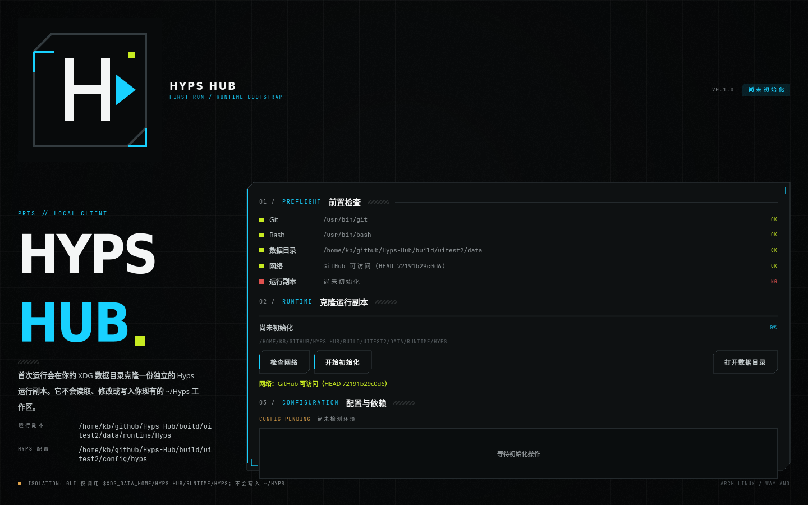
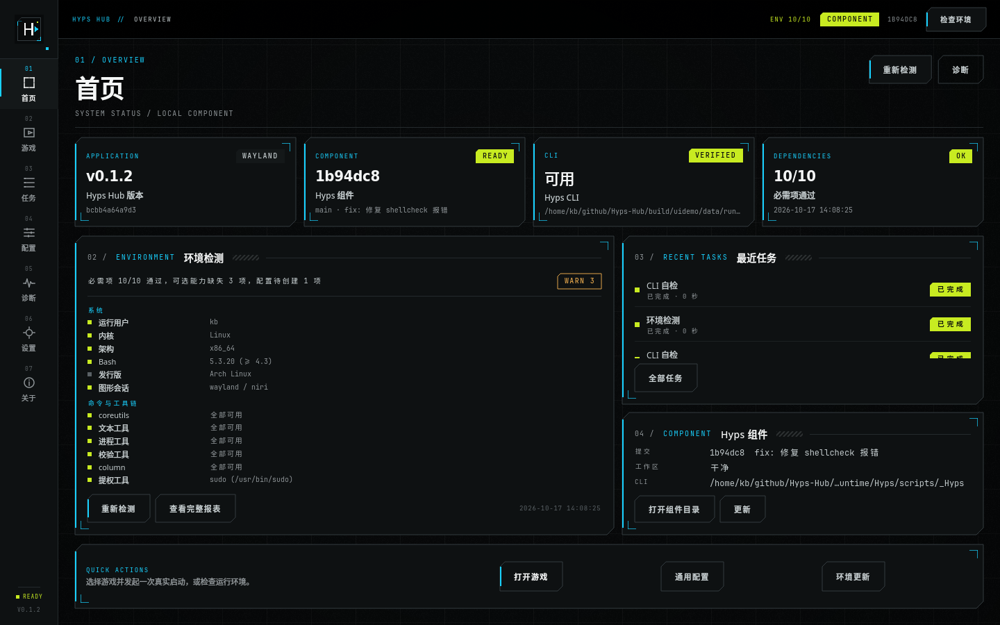
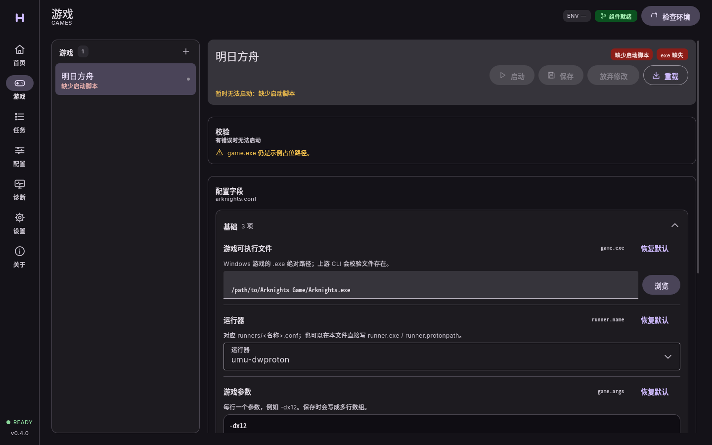
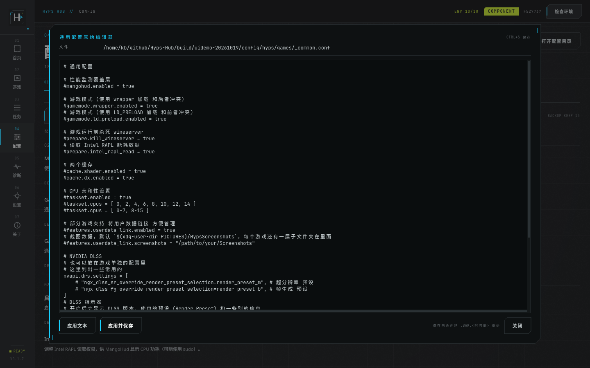
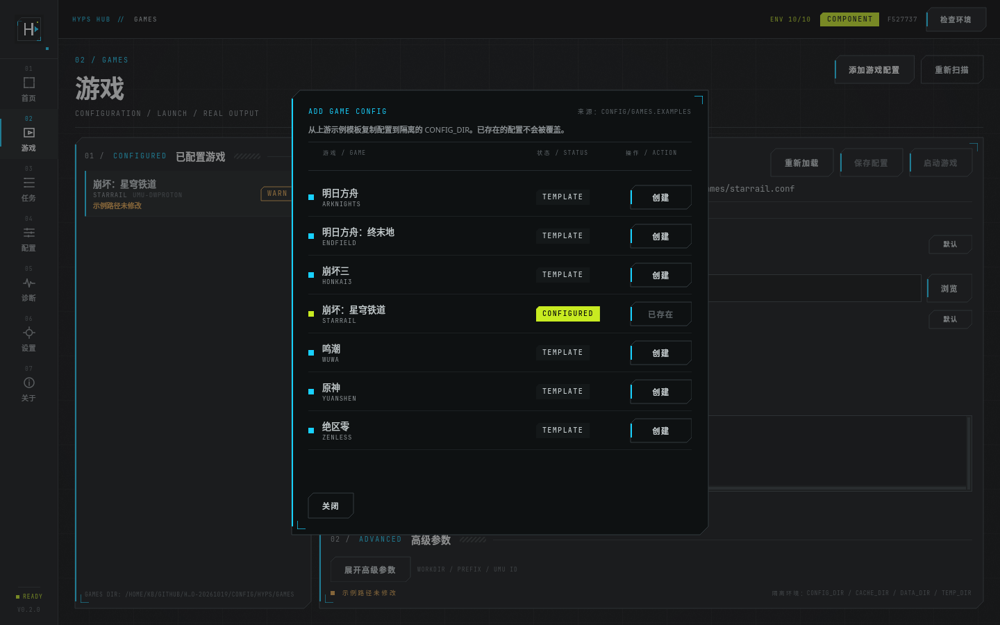
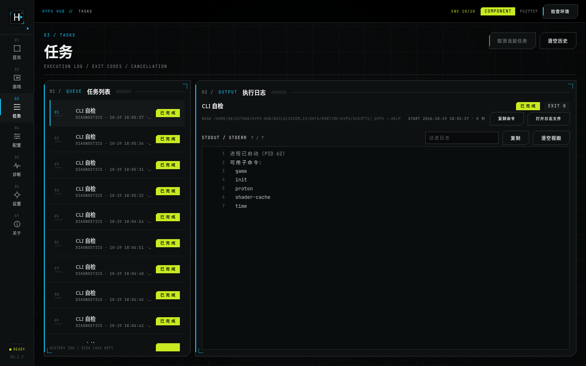
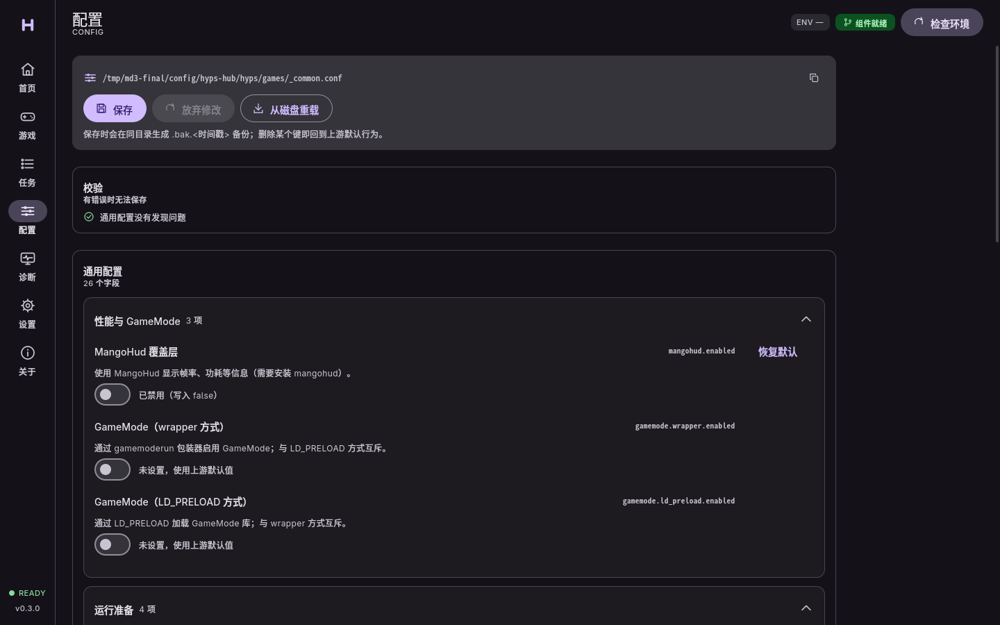
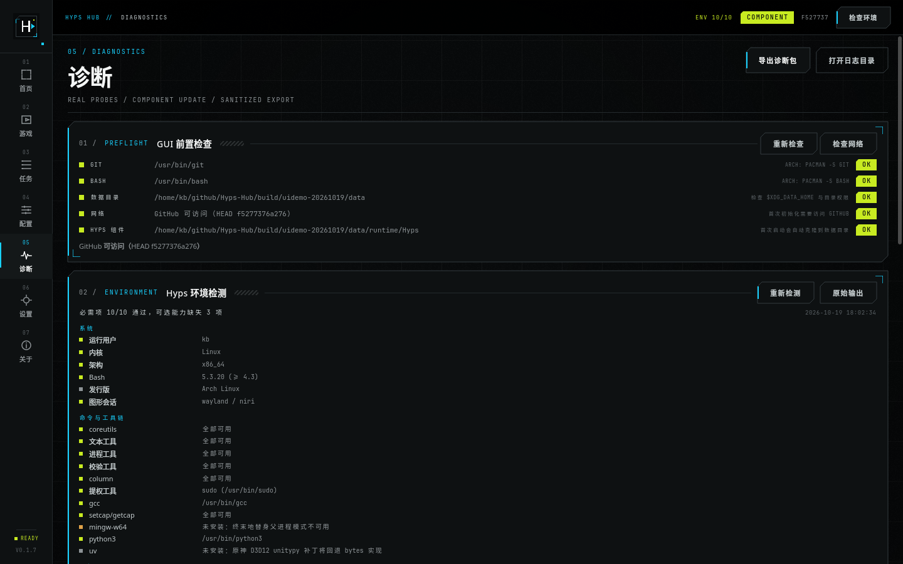
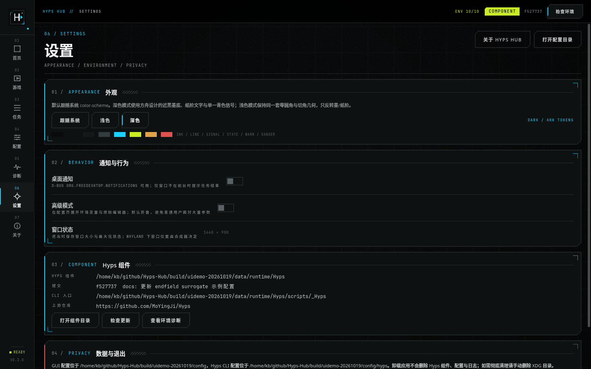
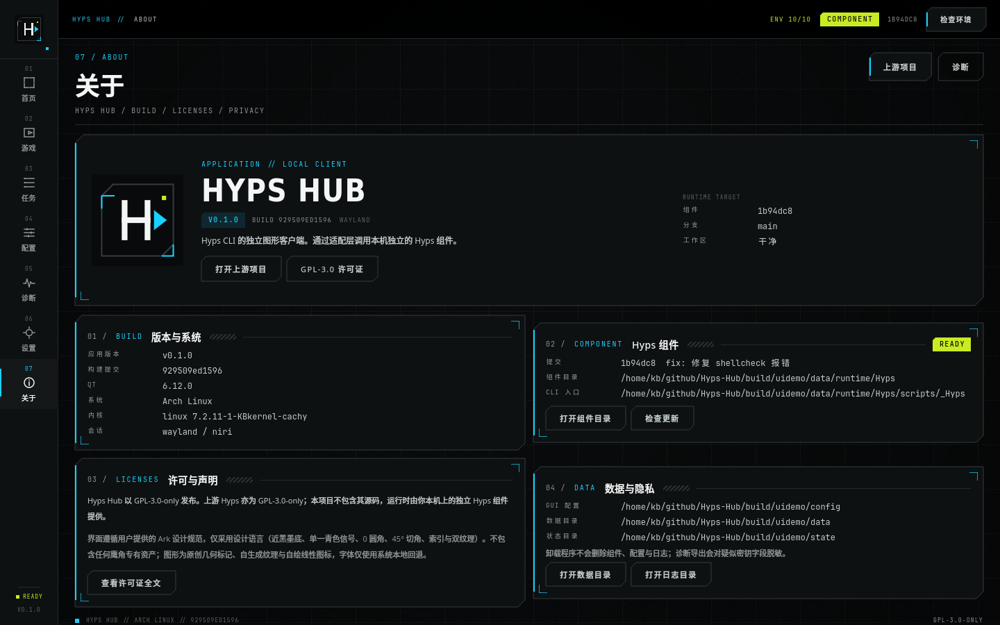

# Hyps Hub

[](https://github.com/K-Blaaaack/Hyps-Hub/actions/workflows/ci.yml)
[](https://github.com/K-Blaaaack/Hyps-Hub/actions/workflows/release.yml)

Hyps Hub 是 [Hyps](https://github.com/MoYingJi/Hyps) CLI 的原生 Linux 桌面客户端（Qt 6 / QML），
目标是让你用图形界面完成 Hyps 的日常操作，同时保持 **GUI 与 CLI 解耦、运行环境独立、数据隔离**。

## 特性

- **首次初始化向导**：检查 Git / Bash / 网络，异步克隆独立的 Hyps 组件（带进度、失败可重试）。
- **完全隔离**：Hyps 组件位于 `$XDG_DATA_HOME/hyps-hub/runtime/Hyps`；调用 CLI 时注入
  `CONFIG_DIR / CACHE_DIR / DATA_DIR / TEMP_DIR`，不写入 `~/Hyps`，也不与 `~/.config/hypsc` 等目录混用。
- **环境检测**：调用上游 `init.sh --check` 并解析真实报表（必需项/可选能力/配置状态）。
- **游戏配置与启动**：读取 `CONFIG_DIR/games/*.conf`，可视化编辑 `game.exe`、`runner.name`、`game.args` 等；
  启动时调用上游 `scripts/<Game>.sh`，实时显示 stdout/stderr、退出码，可按进程组取消任务。
- **终末地替身配置可视化**：游戏页按游戏动态加载字段，`endfield` 额外提供「终末地替身」分区
  （`mode`、`launcher`、替身目录/目标、硬链接与复制目标、`keep`、`exit_after`、`show_info`），
  `mode` 用枚举选择，保存前校验模式冲突与「同一前缀 `dir`/`target` 二选一」。
- **配置管理**：通用配置（MangoHud、GameMode、缓存、taskset、Overlay、时长记录等）与运行器配置可视化编辑；
  保存前校验、自动 `.bak.<时间戳>` 备份、原始文本编辑器（保留注释与顺序）。
- **任务与日志**：任务历史（最多 200 条）、逐任务日志落盘、过滤/复制/清空视图、退出时清理子进程。
- **诊断**：环境报表、Hyps 组件状态、手动检查更新（`git fetch` + `git merge --ff-only`，脏工作区拒绝更新）、
  白名单诊断命令、脱敏诊断包导出。
- **上游同步**：跟随上游 Hyps 的配置契约变化（0.3.0 基线 `a2ac842`）。上游移除的功能（如 hosts 断网）
  同步下线，只对残留键告警；弃用键（如 `gi.fps_unlock.prog`）给出迁移提示而不改动用户配置。
- **Ark 设计语言界面**：近黑墨底、单一青色信号、0 圆角、1px 细线、45° 切角、NN 索引与双纹理；
  跟随系统深浅色，支持手动切换。

## 界面与使用教程

### 01 首次初始化



首次启动会进入独立的初始化向导：

1. 检查 Git、Bash、数据目录与网络；缺失项会直接给出提示。
2. 点击「开始初始化」后，异步克隆上游 Hyps 到 `$XDG_DATA_HOME/hyps-hub/runtime/Hyps`，显示进度与实时日志。
3. 克隆完成后自动执行 `init.sh --no-game`，把配置写入隔离的 `CONFIG_DIR`。
4. 失败可安全重试；已存在的目标目录不会被覆盖，也不会触碰 `~/Hyps`。

### 02 首页



- 四张状态卡展示应用版本、组件提交、CLI 可用性与依赖检测结果。
- 「环境检测」面板展示真实 `init.sh --check` 报表，可滚动查看全部项目。
- 右侧展示最近任务与组件详情（提交、分支、工作区、CLI 入口）。
- 顶部可快速重新检测；底部「快捷操作」可直达游戏、配置与更新检查。

### 03 游戏配置与启动



- 左侧列出 `CONFIG_DIR/games/*.conf` 中的已配置游戏，并标注就绪/警告状态。
- 右侧可视化编辑 `game.exe`、`runner.name`、`game.args` 等字段；保存前校验，并自动生成 `.bak.<时间戳>` 备份。
- 字段按游戏动态加载：`endfield` 会多出「终末地替身」分区（`mode`、`launcher`、替身目录/目标、
  `hardlink_*`/`copy_*`、`keep`、`exit_after`、`show_info`），`mode` 为枚举选择，未启用时不生成替身。
- 底部显示启动命令与隔离环境；只有配置完整且已保存时「启动游戏」才可用。
- 启动通过上游 `scripts/<Game>.sh` 执行，实时输出进入「任务」页。

#### 大窗口原始编辑器



- 点击「原始编辑器」会弹出独立大窗口，不再占用页面底部的小输入框。
- 编辑器支持横向与纵向滚动条（常显）、鼠标选择、`Ctrl+S` 保存。
- 「应用文本」只写入内存等待保存；「应用并保存」会校验、备份并落盘。
- 同一编辑器也用于通用配置与运行器配置。

### 04 添加游戏配置



- 来源是组件内的 `config/games.examples`，不会读取 `~/Hyps`。
- `TEMPLATE` 表示隔离配置目录中还没有该游戏；点击「创建」复制示例配置，不会覆盖已有文件。
- 创建后变为 `CONFIGURED`，再回到游戏页填写 `game.exe` 与运行器即可。

### 05 任务与日志



- 左侧任务列表显示状态、时间、耗时与退出码；右侧实时显示 stdout/stderr。
- 支持过滤、复制、清空视图、取消运行中的任务（按进程组终止）。
- 历史任务最多保留 200 条；每个任务的完整日志保存在 `logs/tasks/`。
- 重启后打开历史任务会自动从磁盘载入日志。

### 06 配置管理



- 「通用配置」按功能分组展示 MangoHud、GameMode、缓存、taskset、Overlay、时长记录等开关。
- 每个字段可恢复默认（删除该键）；未知键可通过「原始编辑器」修改，保存前完整校验。
- 「运行器」页只允许编辑隔离配置目录中的 `runners/*.conf`，来自组件的文件会标记只读。
- 「路径」页展示 GUI 配置、组件、缓存、数据、状态等真实目录，并可打开。

### 07 诊断



- GUI 前置检查（Git/Bash/数据目录/网络/组件）全部来自真实检测。
- 环境报表、组件更新状态（`git fetch` + `git merge --ff-only`，脏工作区拒绝）。
- 白名单诊断命令：环境检测、CLI 帮助、游戏列表、Proton 列表、游玩时长。
- 可导出脱敏诊断包（summary、环境报表、任务历史、日志尾部、SHA 说明）。

### 08 设置



- 主题跟随系统，也可固定浅色/深色；保持 Ark 令牌与零圆角几何。
- 桌面通知（D-Bus，服务不可用时静默降级）、高级模式、窗口状态。
- 组件信息与快捷入口；隐私说明与退出行为。

### 09 关于



- 应用版本、构建提交、Qt、系统、内核、会话。
- 组件提交、分支、工作区、组件目录与 CLI 入口。
- 作者/维护者、GPL-3.0-only 许可、原创资产声明、数据目录与隐私说明。

## 依赖

运行时：

- Arch：`qt6-base qt6-declarative qt6-svg bash git`
- 运行游戏还需要上游 Hyps 所需的依赖（`umu-launcher`、Proton、MangoHud、GameMode、gamescope 等）。
  Hyps Hub 不重复实现这些依赖，只在诊断中展示缺失项。

构建：

```bash
sudo pacman -S --needed base-devel cmake ninja qt6-base qt6-declarative qt6-svg
```

## 构建与运行

```bash
cmake -S . -B build -G Ninja -DCMAKE_BUILD_TYPE=Release -DBUILD_TESTING=ON
cmake --build build
ctest --test-dir build --output-on-failure
./build/hyps-hub
```

或使用脚本：

```bash
./scripts/build.sh          # 构建 + 测试
./scripts/run.sh            # 构建后启动
```

## 安装

### 本地安装（无需 root）

```bash
./scripts/install-local.sh  # 安装到 ~/.local
```

### Arch Linux 包

```bash
# 在仓库根目录生成源码包（PKGBUILD 使用本地源码包）
git archive --prefix=hyps-hub-0.3.0/ -o hyps-hub-0.3.0.tar.gz HEAD
mkdir -p /tmp/hyps-hub-pkg && cp packaging/PKGBUILD hyps-hub-0.3.0.tar.gz /tmp/hyps-hub-pkg/
cd /tmp/hyps-hub-pkg && makepkg -f
```

详见 [docs/install.md](docs/install.md)。

## 上游同步

当前版本 **0.3.0**，对应上游 Hyps 提交 `a2ac842`（基线 `1b94dc8`）。

| 上游变化 | Hyps Hub 处理 |
| --- | --- |
| `hosts_disconnect` 功能移除 | 通用配置不再提供该字段；旧配置残留键只告警，不删除、不迁移 |
| 终末地替身配置重构（`endfield.surrogate.*`） | 游戏页新增「终末地替身」分区，并按上游语义校验模式冲突与目标互斥 |
| `gi.fps_unlock.prog` 弃用 | 键仍可见可编辑，校验给出弃用提示（上游改为取 `game.exe` basename） |

组件升级仍走快进合并（`git fetch` + `git merge --ff-only`），脏工作区拒绝更新。逐提交的变更、
影响面与 GUI 适配明细见 [docs/upstream-sync-2026-10-27.md](docs/upstream-sync-2026-10-27.md)。

## 数据与隔离

| 路径 | 内容 |
| --- | --- |
| `~/.local/share/hyps-hub/runtime/Hyps` | 独立 Hyps Git Hyps 组件 |
| `~/.local/share/hyps-hub/logs` / `cache` / `hyps-data` | 日志、缓存、prefix/overlay/时长记录 |
| `~/.config/hyps-hub/config.json` | Hyps Hub 自身配置 |
| `~/.config/hyps-hub/hyps` | 注入给 Hyps CLI 的 `CONFIG_DIR` |
| `~/.local/state/hyps-hub` | 任务历史、环境检测结果、更新历史 |

实际路径按 `XDG_DATA_HOME` / `XDG_CONFIG_HOME` / `XDG_STATE_HOME` 解析。

**卸载应用不会删除 Hyps 组件、配置与日志**；需要彻底清理时手动删除上述目录。

## 安全边界

- 所有 CLI 调用都经过 `HypsAdapter`，使用程序 + 参数数组，不经过 shell，不提供任意命令执行器。
- 更新仅在 Git 工作区干净时执行 `fetch` + `merge --ff-only`；从不执行 `reset --hard` / `clean`。
- Git 子进程使用净化后的环境，禁用仓库/全局钩子，并把 `origin` 固定到编译期上游。
- 克隆失败只清理本次创建的 `runtime/.Hyps.clone-*` 临时目录。
- 诊断导出对常见 `Authorization: Bearer`、`--token/--password`、JSON/引号值和 URL 凭据脱敏；仍建议分享前自行检查。
- 同一 `XDG_STATE_HOME` 只允许一个实例，避免并发覆盖配置、任务历史或组件更新。
- 关闭窗口时检查运行任务和未保存配置；原始编辑器关闭时也会确认放弃修改。
- 默认拒绝 root；上游 CLI 本身也会拒绝 root。调试可用 `--allow-root` 显式覆盖。

## 开发

架构、适配层契约、测试与设计规范见：

- [docs/research.md](docs/research.md) — 上游调研、能力映射、技术选型
- [docs/architecture.md](docs/architecture.md) — 分层、目录、状态机、适配层
- [docs/development.md](docs/development.md) — 构建、测试、调试
- [docs/verification.md](docs/verification.md) — 构建、测试、打包与验收记录
- [docs/upstream-sync-2026-10-27.md](docs/upstream-sync-2026-10-27.md) — 0.3.0 上游同步（`1b94dc8` → `a2ac842`）
- [docs/troubleshooting.md](docs/troubleshooting.md) — 故障排查
- [docs/design/](docs/design/) — Ark 设计语言参考（仅设计语言，不含鹰角专有资产）

## 已知限制

- 上游没有游戏库扫描、自动下载/安装游戏或 Proton 的能力，Hyps Hub 也不会伪造这些功能。
- 游戏启动的真实性依赖用户已安装的游戏与 Proton/umu 环境；自动化测试使用假 Hyps 组件验证适配层，不启动真实游戏。
- 游戏/Proton 进程继承真实 `HOME` 与用户会话环境；本项目隔离 CLI 的 CONFIG/CACHE/DATA/TEMP，不是文件系统沙箱。
- 诊断导出在主线程执行；单个日志最多读取尾部 512 KiB、最多 10 个任务日志，但仍可能造成短暂 UI 停顿。
- 可访问性已补键盘导航与角色，但尚未做完整 WCAG/屏幕阅读器认证。
- 任务日志保留最近 200 个；清空历史会同时删除对应任务日志。运行日志按 2 MiB 轮转，更新历史保留最近 200 条。
- 更新使用 Git 快进合并；如果本地 Hyps 组件存在未提交修改，GUI 会拒绝更新，需要用户手动处理。
- 上游已移除 hosts 断网功能，Hyps Hub 同步下线；旧配置里的 `features.hosts_disconnect.*` 残留键只告警，需自行清理。
- 终末地替身模式由上游 C 工具实现，需要 `mingw-w64-gcc` 编译；`launcher` 模式还要求本机已安装官方启动器。
- 未提供 Flatpak/AppImage：沙箱对宿主机 GPU/游戏环境有实际限制，不做未验证的交付。
- 未实现 P1/P2 的配置导入导出、桌面通知的细粒度设置、多运行环境模板等，详见架构文档。

## 许可

GPL-3.0-only。上游 Hyps 亦为 GPL-3.0-only，但本项目不包含其源码；运行时由用户机器上的独立组件提供。

## 引用来源与鸣谢

**特别鸣谢 [MoYingJi](https://github.com/MoYingJi)** —— 上游 [Hyps](https://github.com/MoYingJi/Hyps) 的作者，
本项目的 CLI、初始化、配置格式与游戏启动逻辑均来自该项目。

- **上游项目**：[MoYingJi/Hyps](https://github.com/MoYingJi/Hyps)（GPL-3.0-only）。Hyps Hub 不包含其源码。
- **设计语言参考**：[Brandon030722/ark-ui-skill](https://github.com/Brandon030722/ark-ui-skill)、
  [《明日方舟》UI/UX 分析](https://gameinstitute.qq.com/index.php/knowledge/100122)（腾讯游戏学院 / AJ）、
  [ignoredone.space 字体库](https://www.ignoredone.space/index.php/fontlab/)、
  [《「舟味」从何而来》PDF](https://janniewang.net/wp-content/uploads/2023/09/UIUX-analysis-for-Arknights.pdf)。
- **框架与工具**：Qt 6 / Qt Quick Controls 2、CMake、Ninja、GitHub Actions、Arch Linux `makepkg`。
- **原创内容**：应用 logo、自绘导航图标、生成的噪点/警戒线纹理、界面与文档；字体仅使用系统本地回退。

界面只采用设计语言，不包含鹰角网络的商标、logo、立绘、图标表或字体文件。
本项目与鹰角网络、明日方舟无隶属或背书关系。

完整来源、许可与致谢见 [docs/credits.md](docs/credits.md)。
